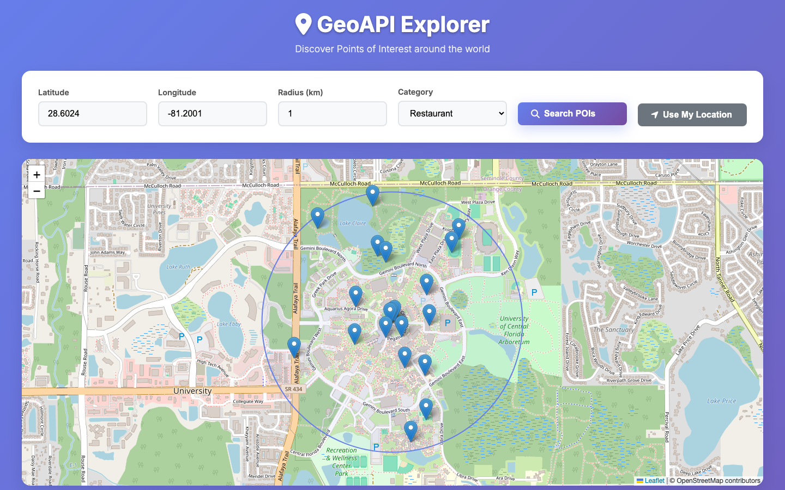

# Geo-Enabled Points-of-Interest API

A REST API and map UI for finding points of interest within a radius, built with Django 5, Django REST Framework, GeoDjango, and PostgreSQL 15 + PostGIS 3.

<p align="center">
  
</p>

Radius search runs as an index-backed `ST_DWithin` query on a PostGIS **geography** column, so distances are in meters and the GIST spatial index is used. Results include the distance from the query point and can be filtered by category and minimum rating.

---

## Quickstart

Requires Docker.

```bash
git clone https://github.com/prachics/geo-enabled-poi-api.git
cd geo-enabled-poi-api
docker compose up -d                                        # Postgres + PostGIS, Django on :8000
docker compose exec web python manage.py load_sample_data   # 50 random POIs around NYC

curl "http://localhost:8000/api/pois/pois/?lat=40.7580&lng=-74.0060&radius_km=5"
```

Map UI: `http://localhost:8000/` · Interactive API docs: `http://localhost:8000/api/docs/`

`env.sample` lists the settings to change for a production deployment (secret key, `DEBUG`, allowed hosts).

---

## Results

Measured with `scripts/bench.sh` (wrk, 4 threads, 10 connections, 30 s per case).

- **Machine:** Apple M4 Pro, 24 GB, Docker Desktop (12 CPUs, 8 GB for the VM)
- **Server:** Gunicorn 23, 4 sync workers, `DJANGO_DEBUG=False` (`docker-compose.gunicorn.yml`)
- **Data:** 100,000 POIs generated within 50 km of Times Square (about 10,000 of them within 5 km of the query center)

| Query | Requests/sec | Median latency | p90 | p99 |
|---|---:|---:|---:|---:|
| 5 km radius, uncached | 35 | 222 ms | 229 ms | 272 ms |
| 40 km radius, uncached | 6.9 | 1.12 s | 1.15 s | 1.38 s |
| 5 km radius, cached | 2,547 | 1.7 ms | 3.1 ms | 24 ms |
| 40 km radius, cached | 2,642 | 1.7 ms | 3.2 ms | 727 ms |

*Uncached*: every request uses a different random center within ~2 km of Times Square, so it misses the 5-minute
response cache and runs the spatial query. *Cached*: the same URL repeatedly; after the first request it is served from
Django's response cache (per worker process). The cached runs had 8 connect errors each, out of ~77,000 requests.

Uncached throughput is bound by how many queries run at once: 4 sync workers run at most 4. With
`--workers 4 --threads 4` the same 5 km uncached case does 71 requests/sec at a 127 ms median, and the threaded
development server does 64 requests/sec at 132 ms.

Reproduce:

```bash
docker compose -f docker-compose.yml -f docker-compose.gunicorn.yml up -d --build
docker compose exec web python manage.py generate_random_pois --count 100000 --radius-km 50
./scripts/bench.sh                         # BASE=http://localhost:8000 by default
```

---

## Design notes

- **Geography, not geometry.** Coordinates are stored as a PostGIS `geography(Point, 4326)`, so `ST_DWithin` takes a radius in meters directly. Storing them as a 4326 *geometry* would make distances degrees, which is the most common radius-search bug.
- **Index-backed filtering.** GeoDjango creates a GIST index on the location column; the radius filter runs before distance sorting so the index does the narrowing.
- **Composite indexes** on `(category, created_at)` and `(rating, category)` support the optional filters.
- **Where the time goes.** `EXPLAIN ANALYZE` on the 5 km query: the GIST index scan takes ~3 ms; computing exact
  geodesic distances for the ~10,000 matching rows to return the nearest 100 takes most of the ~100 ms. Ordering by the
  KNN operator (`<->`) didn't help here, because the planner still sorts the filtered rows.

---

## API

| Endpoint | Method | Description |
|---|---|---|
| `/api/pois/pois/` | GET | Radius search (`lat`, `lng`, `radius_km`; optional `category`, `min_rating`) |
| `/api/pois/` | GET / POST | List or create POIs |
| `/api/pois/categories/` | GET | Available categories |
| `/api/pois/stats/` | GET | Dataset statistics |
| `/health/`, `/health/ready/` | GET | Liveness and readiness checks |
| `/api/docs/` | GET | OpenAPI documentation |

Example:

```bash
curl "http://localhost:8000/api/pois/pois/?lat=40.7580&lng=-74.0060&radius_km=10&category=landmark&min_rating=4.5"
```

---

## Testing

```bash
docker compose exec web python -m pytest -q
```

19 tests: models and spatial operations, API endpoints and serializers, radius search with filters (including a
regression test that a point 50 km away is not returned by a 5 km search), invalid coordinates and radius, and health
checks.

---

## Stack

| Layer | Choice |
|---|---|
| API | Django 5, Django REST Framework |
| Spatial | GeoDjango, PostgreSQL 15 + PostGIS 3 |
| Runtime | Python 3.12, Gunicorn, Docker Compose |
| CI | GitHub Actions |
| Load testing | wrk |

## License

MIT
